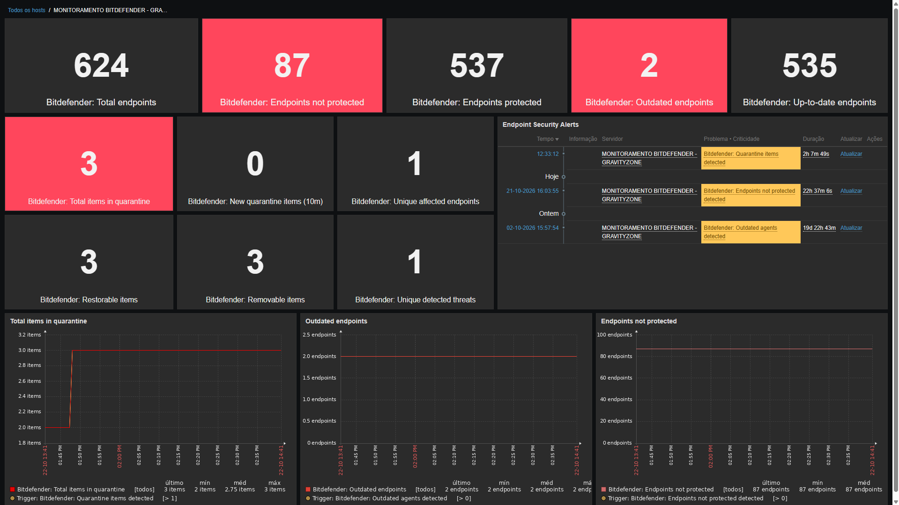

[](https://www.zabbix.com/)
[](https://www.bitdefender.com/business/)
[](LICENSE)

# Bitdefender GravityZone Zabbix Template

Monitor Bitdefender GravityZone Cloud using the Zabbix HTTP agent and the GravityZone Public API.

**Repository:** https://github.com/luizcarmo1/bitdefender-gravityzone-zabbix-template
Monitor **Bitdefender GravityZone** using the Zabbix HTTP agent and the GravityZone Public API.

This project provides a Zabbix template for monitoring endpoint protection status, outdated security agents, and quarantine activity through a centralized dashboard.

## Features

- **Endpoint inventory:** Monitor the total number of endpoints.
- **Protection status:** Track protected and unprotected endpoints.
- **Outdated agents:** Monitor endpoints running outdated Bitdefender BEST products.
- **Quarantine monitoring:** Track quarantined items, affected endpoints, and detected threats.
- **Quarantine capabilities:** Monitor items that can be restored or removed.
- **Security alerts:** Generate Zabbix problems for unprotected endpoints, outdated agents, and quarantine activity.
- **Centralized monitoring:** Collect data through the GravityZone Public API using Zabbix HTTP requests and JavaScript preprocessing.

## Dashboard

The template includes a Zabbix dashboard for monitoring Bitdefender GravityZone endpoint protection and quarantine activity.

### Overview



### Quarantine Monitoring


## Compatibility

| Component | Supported version |
|---|---|
| Zabbix server | 7.0 LTS |
| Bitdefender GravityZone | Cloud |
| Data collection | GravityZone Public API over HTTPS |

Other Zabbix versions have not necessarily been tested.

## Repository structure

```text
Applications/
└── Anti-Virus/
    └── Bitdefender/
        └── template_bitdefender_gravityzone/
            └── 7.0/
                ├── README.md
                └── template_bitdefender_gravityzone.yaml
```

## Installation

1. Download `template_bitdefender_gravityzone.yaml` from the [`7.0` directory](Applications/Anti-Virus/Bitdefender/template_bitdefender_gravityzone/7.0/).
2. Import the YAML file into your Zabbix frontend.
3. Configure the required template macros using your GravityZone API credentials.
4. Link the template to a host.
5. Verify the latest data and configure the dashboard according to your monitoring requirements.

See the [Zabbix 7.0 setup guide](Applications/Anti-Virus/Bitdefender/template_bitdefender_gravityzone/7.0/README.md) for detailed configuration instructions.

## Security considerations

- Store the GravityZone API key in a Zabbix **Secret text** macro.
- Grant the API key only the permissions required by the monitoring features you intend to use.
- Use HTTPS for API communication.
- Never commit API keys, credentials, or sensitive environment information to the repository.

## Contributing

Bug reports, suggestions, documentation improvements, and pull requests are welcome.

Before submitting changes, validate the template import and test the affected items, preprocessing steps, and triggers in a supported Zabbix environment.

## License

This project is licensed under the MIT License. See the [LICENSE](LICENSE) file for details.

## Author

Created and maintained by [Luiz Carmo](https://github.com/luizcarmo1).

## Disclaimer

This is a community project and is not an official Bitdefender or Zabbix product. Bitdefender and GravityZone are trademarks of their respective owners.